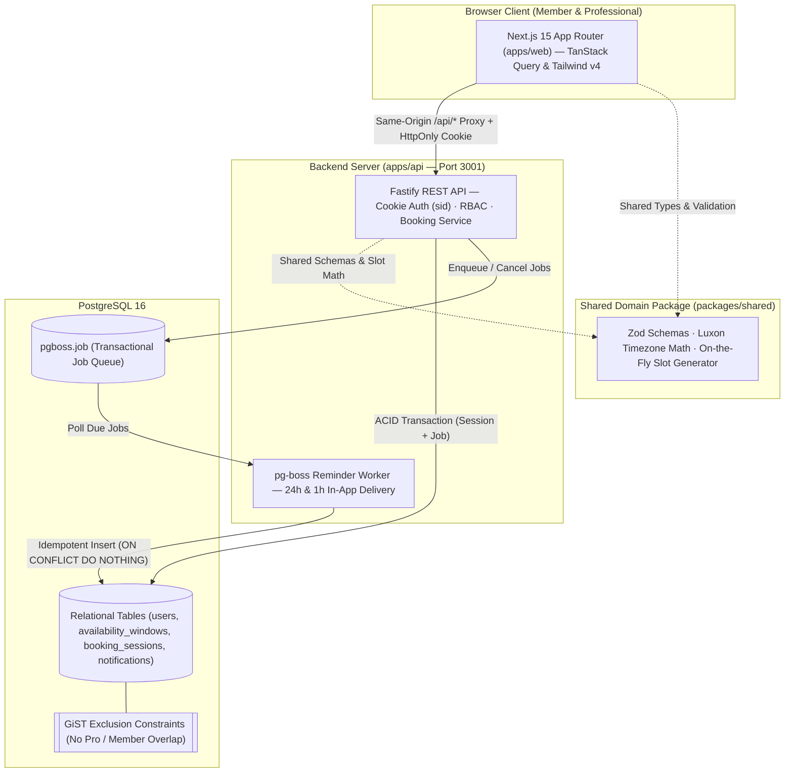
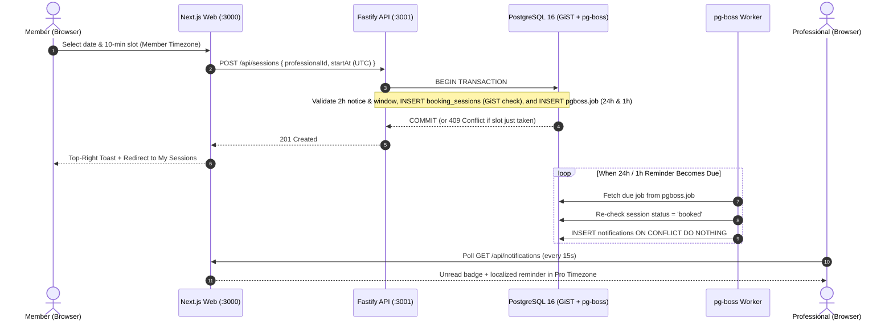

# BookingBro — Timezone-Aware Session Booking & Reminders

BookingBro is a full-stack wellbeing and counselling session booking platform built with **TypeScript, Next.js 15 (App Router), Fastify, Drizzle ORM, PostgreSQL (`btree_gist` exclusion constraints), `pg-boss`, and Luxon**.

Professionals configure recurring weekly working windows (up to 3 windows/weekday on a 10-minute grid) and a post-session rest buffer (`10`, `20`, or `30` minutes) in their own IANA timezone. Members browse a 28-day calendar rendered in their local timezone, book 50-minute sessions with database-enforced double-booking protection, cancel or atomically reschedule sessions (`>= 24h` notice for members; anytime cancellation for professionals), and receive idempotent `24h` and `1h` in-app reminders powered by `pg-boss`.

---

## Architecture Overview

BookingBro is organized as a **pnpm monorepo** with three workspaces (`apps/web`, `apps/api`, `packages/shared`) backed by a single **PostgreSQL 16** instance that handles relational storage, concurrency exclusion constraints (`btree_gist`), and durable background reminder jobs (`pg-boss`) inside the same ACID transaction.

### 1. System Topology & Workspace Boundaries



### 2. Booking, Concurrency & Reminder Lifecycle



### 3. Architectural Layers & Core Guarantees

| Layer | Workspace / Tech | Responsibility | Core Invariant / Guarantee |
| :--- | :--- | :--- | :--- |
| **Presentation & State** | `apps/web` (Next.js 15, TanStack Query) | 28-day two-column calendar, timezone switcher, session management, 15s notification polling | All timestamps travel as UTC ISO-8601 and render in the active user's IANA timezone |
| **Shared Domain Logic** | `packages/shared` (TypeScript, Zod, Luxon) | Request/response schemas, 10-minute slot generator, DST & 24h modification rules | Pure, deterministic functions shared by API and Web with zero I/O dependencies |
| **API & Auth** | `apps/api` (Fastify, Drizzle ORM, `argon2id`) | Server-side session cookies (`SHA-256` hash), RBAC, booking/cancel/atomic reschedule | Actor identity resolved strictly from `HttpOnly` cookie (`req.user`), never from request body |
| **Concurrency Guard** | PostgreSQL `btree_gist` | Prevents double-booking for the same professional (`[start_at, blocked_until)`) or member (`[start_at, end_at)`) | Enforced at the database level via `EXCLUDE USING gist (...) WHERE (status = 'booked')` |
| **Reliable Reminders** | `pg-boss` + `notifications` | Schedules `24h` and `1h` reminders in the same DB transaction as the booking or reschedule | Delivered **exactly once** via `UNIQUE (session_id, user_id, kind)` + `ON CONFLICT DO NOTHING` |

---

## Quick Start (1–2 Commands)

### Option A: Full-Stack Docker Compose (Recommended for Reviewers)

Starts PostgreSQL 16, runs schema migrations + `btree_gist` exclusion constraints, seeds synthetic demo accounts (including a live `pg-boss` reminder job that fires ~8 seconds after startup), starts the Fastify API + worker on `:3001`, and serves the Next.js web UI on `:3000`:

```bash
docker compose up --build
```

Then open **http://localhost:3000** in your browser.

---

### Option B: Local Development (Hot Reload with Turbopack & `tsx watch`)

1. **Start PostgreSQL 16** (via Docker or local Postgres on port `5432`):
   ```bash
   docker compose up -d postgres
   ```
2. **Install dependencies, migrate, seed, and start dev servers**:
   ```bash
   pnpm install && pnpm db:migrate && pnpm db:seed && pnpm dev
   ```
   - **Web UI**: http://localhost:3000 (Next.js 15 + Turbopack)
   - **Fastify API**: http://localhost:3001

---

## Seeded Demo Accounts

All seeded demo accounts share the password **`Password123!`** and can also be logged into with **1 click** from the `/login` page:

| Name | Role | Email | Default Timezone | Pre-Seeded State |
| :--- | :--- | :--- | :--- | :--- |
| **Mei Lin Tan** | `member` | `mei.tan@example.com` | `Asia/Singapore` | Has 1 upcoming session `> 24h` away (reschedulable/cancellable), 1 upcoming session `< 24h` away (locked badge), 1 past session, and a live `1h` reminder firing ~8s after seed |
| **Alex Rivera** | `member` | `alex.rivera@example.com` | `America/New_York` | Cross-timezone member with an upcoming session booked with Dr. Oliver Grant (`Europe/London`) |
| **Dr. Aisha Lim** | `professional` | `dr.aisha.lim@example.com` | `Asia/Singapore` | Clinical Psychologist · `10m` buffer · Mon–Fri `09:00–12:00`, `14:00–18:00` |
| **Dr. Oliver Grant** | `professional` | `dr.oliver.grant@example.com` | `Europe/London` | CBT Therapist & Executive Coach · `20m` buffer · Mon–Fri `09:00–13:00`, `14:30–18:00` |

---

## Running Tests & Quality Gates

Ensure PostgreSQL is running on `localhost:5432` (contains both `booking_bro` and `booking_bro_test` databases, created automatically by `./docker/postgres/init.sql`), then run:

```bash
pnpm test
```

What `pnpm test` executes (**64 tests total** across 3 workspaces):
- **`@booking-bro/shared` (31 unit tests)**:
  - 10-minute grid validation, `>= 50m` UTC window span validation, strict window gap enforcement, 2h minimum notice, 24h member lock vs. professional anytime cancel, on-the-fly slot generation across timezones, spring-forward DST gap handling, and reminder schedule calculation.
- **`@booking-bro/api` (27 real-PostgreSQL integration & concurrency tests)**:
  - **Concurrency (`concurrency.test.ts`)**: `Promise.all` simultaneous same-slot booking (`201` + `409`), buffer overlap rejection (`409`), same-member cross-professional overlap (`409`), and member vs. professional buffer asymmetry proof.
  - **Session Lifecycle (`sessions.test.ts`)**: 24h member lock (`422`), professional anytime cancel (`200`), atomic reschedule rollback on conflict, adjacent `+10m` same-day self-exclusion reschedule (`200`), chained reschedules `A -> B -> C` + cancel `C` without notification unique constraint collision, and schedule edits preserving existing bookings.
  - **Reminders & Security (`reminders-and-auth.test.ts`)**: Idempotent `ON CONFLICT DO NOTHING` reminder delivery, cancelled/rescheduled job suppression, expired `auth_sessions` cleanup (`401`), case-insensitive duplicate email (`409`), cross-role RBAC (`403`), actor spoofing resistance, and public calendar privacy (`{ startAt, endAt }[]` only).
- **`@booking-bro/web` (6 unit tests)**:
  - 28-day calendar grouping into Morning/Afternoon/Evening periods in the viewer's timezone, cross-timezone formatting, and compact timezone pill formatting.

### Additional Commands

| Command | Description |
| :--- | :--- |
| `pnpm dev` | Run `packages/shared` watcher, `apps/api` (`tsx watch`), and `apps/web` (`next dev --turbo`) in parallel |
| `pnpm test` | Run all 64 unit and real-PostgreSQL integration/concurrency tests |
| `pnpm typecheck` | Run `tsc --noEmit` across all 3 workspaces |
| `pnpm lint` | Run type & lint checks across all workspaces |
| `pnpm build` | Build `@booking-bro/shared`, `@booking-bro/api`, and `@booking-bro/web` |
| `pnpm db:migrate` | Apply `0000_init.sql` (`btree_gist` exclusion constraints + tables) idempotently |
| `pnpm db:seed` | Seed demo accounts, availability windows, sessions, and live `pg-boss` reminder jobs |

---

## Repository Structure & Documentation

```text
booking-bro/
├── apps/
│   ├── api/                  # Fastify REST API, Drizzle schema/migrations, pg-boss worker & integration tests
│   └── web/                  # Next.js 15 App Router UI, 28-day calendar, TanStack Query & unit tests
├── packages/
│   └── shared/               # Shared Zod schemas, domain constants, Luxon slot generator & unit tests
├── docker/postgres/init.sql  # Initializes booking_bro and booking_bro_test databases
├── SPEC.md                   # Complete system specification, invariants, API contracts & test matrix
├── DECISIONS.md              # Architecture Decision Records (ADRs), trade-offs & healthcare production readiness
├── AI_USAGE.md               # AI tools used, workflow, human overrides & verification methodology
├── CONSTRAINTS.md            # Enforced quality bar (zero @ts-ignore, eslint-disable, .skip, or any)
└── log.txt                   # Append-only turn-by-turn prompt and token telemetry log
```
